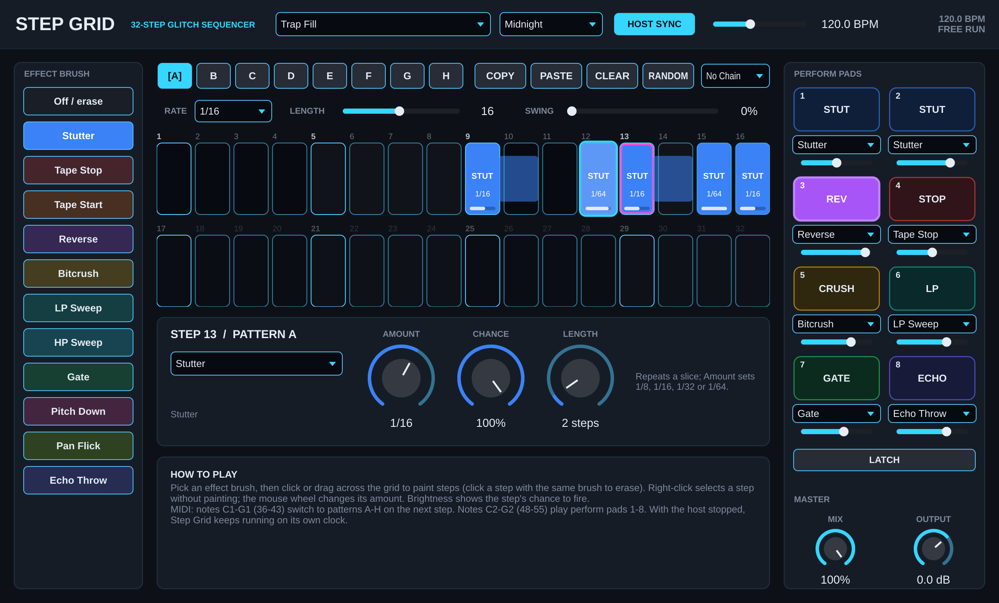

# Step Grid (working name)

A 32-step glitch and pattern sequencer (VST3 + AU + standalone). Each step fires an effect on the
incoming audio: Stutter, Tape Stop, Tape Start, Reverse, Bitcrush, LP/HP sweep, Gate, Pitch Down,
Pan Flick or Echo Throw. Eight pattern slots that switch from MIDI or a click, chains, 40 factory
patterns, and eight perform pads that override the grid while held. See `docs/DESIGN.md`.



## Build

```
cmake -B build -DCMAKE_BUILD_TYPE=Release            # fetches JUCE 8.0.4
# or: cmake -B build -DJUCE_DIR=/path/to/JUCE
cmake --build build --config Release
ctest --test-dir build                                # engine tests
```

macOS builds target macOS 11+ universal (Intel + Apple Silicon). No AVX2 or other
`-march` flags are used; the DSP is scalar C++. Windows builds use the static runtime.
GitHub Actions (`.github/workflows/build.yml`) builds a macOS `.pkg` and a Windows
`Setup.exe`, and attaches both to a GitHub Release when a `v*` tag is pushed.

Layout: `Source/engine` is plain C++ (sequencer clock, effects, patterns, factory presets)
with tests in `tests/`. `Source/plugin` is the JUCE wrapper, UI and themes.
`tools/Snapshot.cpp` renders the docs screenshots (`-DSTEPGRID_BUILD_SNAPSHOT=ON`).
