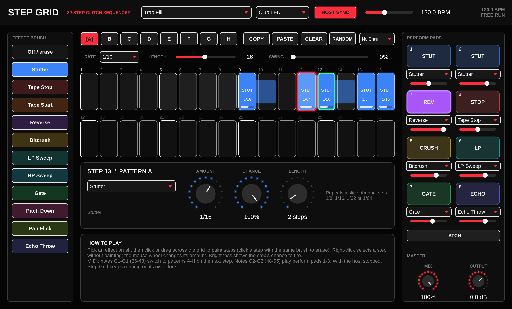

# Step Grid v0.1: design

Working name. A tempo-synced 32-step grid where each step fires an effect on the incoming audio.
Family: guitar & performance (pairs with touchstorm, deckrig, comma-harmonizer, fretwire). It is
about sequenced fills and patterns; touchstorm stays the XY effects box.

## What it has

| Area | Implementation |
|---|---|
| Grid | 32 steps shown as 2 rows of 16 pads, coloured by effect. Brightness = probability, the bar = amount, tied steps join the pad to their left. A playhead sweeps the playing pattern. |
| Per step | Effect, Amount, Chance (probability, rolled each pass), Length (ties 1 to 16 steps into one longer effect). |
| Per pattern | Rate (1/8, 1/8T, 1/16, 1/16T, 1/32, 1/32T), Length (1 to 32 steps), Swing (odd steps start up to half a step late). Stored with the pattern, so a triplet fill can follow a straight groove. |
| Effects | Off, Stutter (Amount picks 1/8, 1/16, 1/32 or 1/64), Tape Stop, Tape Start, Reverse, Bitcrush (10 to 3 bits plus sample-rate hold), LP sweep, HP sweep, Gate (1/32 chop), Pitch Down (0 to 12 semitones), Pan Flick (alternates left/right), Echo Throw (dotted-1/8 ping-pong whose tail outlives the step). |
| Patterns | 8 slots (A-H). Click a slot or send MIDI notes 36-43 (C1-G1): the switch lands on the next step and keeps the song position. Chain plays A to the chosen slot in order. Copy, Paste, Clear, Random. |
| Presets | 40 factory patterns in Fills, Endings, Builds, Breakdowns, Glitch, Grooves and Transitions (Trap Fill, Tape-Stop Ending, Stutter Build, Breakdown Filter, Glitch Hop, Reverse Turnaround, DJ Echo Out, Random Crunch and more). The preset menu (and host program change) loads one into the selected slot. Slots A-H start with eight of them. |
| Perform | 8 pads, each with its own effect and amount (host parameters). Hold to override the grid; the most recently pressed pad wins. Latch makes pads toggle. MIDI notes 48-55 (C2-G2). |
| Global | Mix, Output, Host Sync, Free BPM. |
| Themes | Midnight, Magma, Mint, Daylight, Vapor (from touchstorm) and Club LED (LED knob rings and glowing pads). Saved per instance. |

## DSP

- **Ring buffer.** The input is always written to a 20-second stereo ring buffer, so Stutter,
  Reverse, Tape and Pitch can read the recent past (more than 2 bars down to 40 BPM).
- **Clock.** With Host Sync on and the host playing, the step position comes from the host's
  quarter-note position, computed per sample, so step boundaries land on the exact sample and
  loops and jumps resync. With the host stopped (or no host, as in deckrig and the standalone)
  it keeps running on its own clock: the host tempo if it reports one, else Free BPM.
- **Voices and crossfades.** Two voices (current and previous) render the effect for each step;
  whenever the effect changes they crossfade over 4 ms, so there are no clicks between steps.
  Stutter repeats get 1 ms edge fades; Tape Stop/Start fade with speed.
- **Effects** share one interface (`Engine::render`): Stutter's first pass is live then the slice
  repeats; Reverse reads backwards from the step start; Tape Stop/Start are variable-rate cubic
  reads with an easing curve; Pitch Down is a two-tap sin² delay shifter reading the ring buffer
  (no cold start); sweeps use touchstorm's TPT state-variable filter.
- MIDI and UI events (pattern select, pads) are applied at their sample offset in the block.

## Tests (`tests/EngineTests.cpp`, 136 checks)

- Step boundaries land on the exact sample (host-synced and free-running, 1-sample and
  512-sample blocks), with swing and triplet grids.
- An effect starts on the first sample of its step and not one sample earlier.
- No clicks: a sine through every smooth effect, pattern switches and pad presses never jumps
  more than about twice the dry sine's own largest step.
- Probability 0 never fires, ties fire once, chains play A then B, pattern switches wait for the
  next step, host jumps resync, pads override the grid and latch, Stutter/Reverse/Tape Stop/Echo
  behave as specified, pattern text round trip and the factory list.

## Not in v0.1 (candidates)

- Per-step parameter locks beyond Amount (e.g. filter resonance), and more than one lane per step.
- MIDI learn and a selectable MIDI note range; MIDI clock in the standalone.
- User pattern files (save/load to disk) and drag-and-drop pattern copy between slots.
- Resizable UI.
